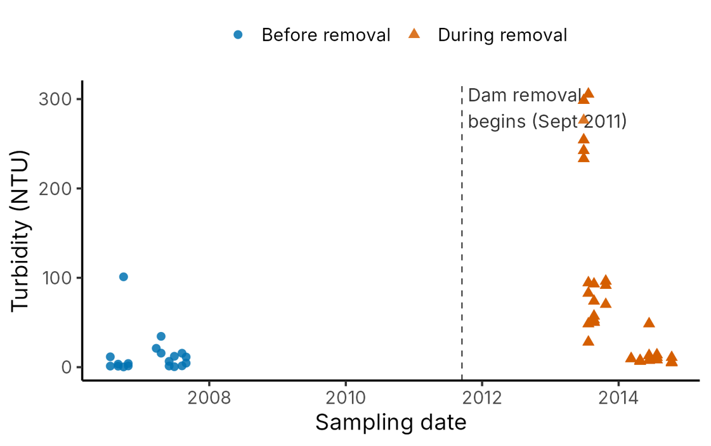
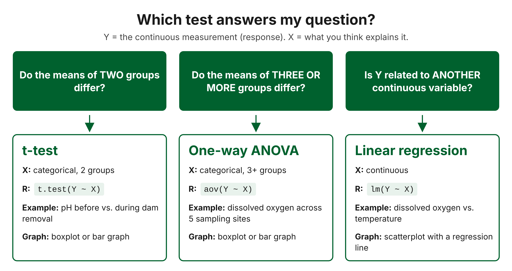

```{css, echo=FALSE, purl=FALSE}
pre code {
  white-space: pre-wrap;
}
```

This is a single-session laboratory activity that introduces students to statistical analysis in [R](https://www.r-project.org/) using publicly available water quality data from the Elwha River estuary (Washington, USA). The data come from the USGS data release [Water quality in the Elwha River estuary, Washington, from 2006 to 2014 (doi:10.5066/F75B00N4)](https://www.usgs.gov/data/ecological-parameters-elwha-river-estuary-and-during-dam-removal-ver-20-august-2020). 

# About this lab
## Materials Needed 
- a computer with an internet browser & internet connection
- a free Posit Cloud account

For this activity, you will use [R](https://www.r-project.org/), a free programming language for statistics and graphics, to analyze real water quality data collected before and during the largest dam removal in history. **You will not need to write code from scratch.** Example code is provided for each step, which you will be able to adapt to accommodate new variables as needed. This lab is intended to be run within the Posit Cloud environment for maximum compatibility and ease of use, but the activity can also be completed locally on any machine where R and RStudio are installed. The HTML output of this markdown functions as the manual for the lab activity, and is written to correspond to the student write-up document that may be turned in for grading. All coding should be completed within the `R_lab_notebook.Rmd` file within the RProject working directory.


## Learning Objectives

After completing this lab activity, you will be able to:

- Import a public dataset into R and identify each variable as
  categorical or continuous 
  
- Calculate descriptive statistics (mean, median, minimum, maximum, standard deviation) by adapting example code to new variables

- Run a t-test, a one-way ANOVA, and a linear regression in R on the
  correct variables and data 
  
- State the null hypothesis for each test and use the p-value to reach a correct conclusion 
  
- Make a box plot, a bar graph with error bars, and a scatter plot with a regression line, each with an informative caption 

- Pose a testable question about a new biological system and choose a test, graph, and null hypothesis to answer it

## Before You Begin
### Using R
R is a programming language and has a strict set of rules. When you run a line of code, you are precisely asking R to do something with certain objects using particular functions located in specific places. R is case sensitive so the names of objects, functions, libraries, filepaths, etc., must be exact or R will produce an error because it cannot recognize the name. R uses a set of operators, or mathematical punctuation with special meanings:

|Symbol|Meaning|Example|
|:----:|:-------------:|:--------------------------------------:|
|`<-`|Store a result in an object with a name|`mean_pH <- mean(Elwha_data$pH, na.rm = TRUE)`|
|`$`|Define column in a data frame|`Elwha_data$Temperature`|
|`~`|"as explained by" in a test or graph|`t.test(pH ~ Dam_Condition, data = Elwha_data)`|
|`#`|A non-coding comment; R ignores the rest of the line|`getwd()  # shows the working directory`|

R uses something called a working directory, which is the location where it will look for files unless told otherwise. This activity utilizes a self-contained RProject so the working directory is already set up for us and located in our Posit Cloud workspace.

Some things to keep in mind:

- R is case sensitive. Be mindful of spaces, punctuation, spelling, etc.
- You must load a library before attempting to use any functions defined by that library. For example, we must load `ggplot2` before we can use the `ggplot` function.
- To run a code chunk within the `R_lab_notebook.Rmd` file, you can either use keyboard shortcuts (e.g., on a Windows machine, you would use CTRL+Enter) or click the green triangle that looks like the "Play" symbol on a video. There is also a drop-down menu called "Run" in the top right corner of the script pane with several options.

A complete guide to using R is available directly from [CRAN (The Comprehensive R Archive Network)](https://cran.r-project.org/doc/manuals/R-intro.html).

### The Elwha Dam
In the early 1900s, two dams were built on the Elwha River on the Olympic Peninsula of Washington State. Together they trapped an estimated 30 million metric tons of sediment and blocked salmon from more than 90% of their spawning and rearing habitat. Between 2011 and 2014 both dams were removed, the largest dam removal project in history. More than 14 million metric tons of sediment flowed downstream, building the river-mouth delta out by more than 400 m and changing the estuary where the river meets the sea (1).
Scientists from the U.S. Geological Survey (USGS) and their partners measured water quality in the Elwha estuary before removal (2006–2007) and during removal (2013–2014) and made the data freely available (2). Figure 1 shows one obvious change: turbidity, a measure of how cloudy the water is with suspended sediment. Today you will ask whether less visible properties of the water, such as pH, dissolved oxygen, and temperature, also changed.
 



# 1. Getting started
## 1.1 Look at the data
Today we will be using a publicly-available dataset from the United States Geological Survey (USGS). The title of the study we are using is: **Ecological parameters in the Elwha River estuary before and during dam removal**. The USGS page is located at this URL: <https://www.sciencebase.gov/catalog/item/58e5437ae4b09da679997d4e>, and the published study is located [here](https://esajournals.onlinelibrary.wiley.com/doi/abs/10.1002/ecm.1268). Look through all of the **Child Items** by clicking **More**; we will be using data from the item entitled: **Water quality in the Elwha River estuary, Washington, from 2006 to 2014**. Visit this page and check out the information provided. You should find a summary of the study, followed by a section titled "Attached Files" that includes two files. The one we are most interested in is the .csv file, or comma-separated values text file. This type of file is viewable as a spreadsheet in Excel, but you can also view it in a text editor like Notepad. **Download this and take a look around at not only what it contains, but how the data are oriented.** It is very important to know if your data are organized in a way that will be understood by the commands you use in your R scripts. When files are in .csv format, it is usually a good sign. The structure of this spreadsheet is critical to analysis in R. Some key things to notice include:

1.  **Data are organized by rows and columns with descriptive column headers.** Cell A1 contains the first column header, and columns continue across row 1. There are no merged cells and there are no empty rows.
2.  **Samples are organized by row, and variables by column.** This format is relatively standard for analyses, especially when we are importing files into R.
3.  **All sampling times are included in a single table of data.** In previous quarters, you might have included multiple trials all on the same sheet, skipping a few rows in between. Our data need to be organized in such a way that the values are continuous, with no missing rows. Check out how the different sampling dates and sites are coded so that they can all be included within the same table.

This is how most types of data should be organized for statistical analysis. However, this .csv file includes several problematic attributes that must be corrected before it can be parsed in R:
1. **Column headers should not have spaces within the names.** This can cause issues when working in R since names must be exact. R will also convert spaces to periods, which can be confused with function names.
2.  **Remove the + and % that appear in two of the column headers.** It will make it easier to refer to these columns in R if we change their names.
3.  **NS (no sample) needs to be replaced with NA**. This is just so R will know to exclude these rows.

It is possible to clean these data in R, but for the purposes of this activity, the cleaned data are provided for you in `cleaned_data.csv`.

## 1.2 Open the project in Posit Cloud
You will need a free Posit Cloud account to complete the rest of the activity.

1. Go to [posit.cloud](posit.cloud) and sign up for a free account (or log in to an existing account).
2. Click **New Project**, then **New Project from Git Repository**.
3. Paste this URL and click OK: `https://github.com/emwolfe/R_lab.git`
4. Wait for the project to open. The repository is a self-contained project directory. Files will appear in the Files tab of the Viewer pane (bottom right).
5. Double-click on `R_lab_notebook.Rmd`. This will open the R Markdown file where this lab was written and all code chunks are housed. The file will corresponding to the .html manual, with the exception of code chunks where your input will be added. You can directly edit this file and run your code within it, or you can type directly into the console (bottom left pane). A simple .R script file is also included in the project directory, which contains only the code examples. Code can be executed line-by-line within the .R script if desired.
6. Click on **File**, then **Save As...**, and use an underscore to append your initials after notebook in the file name. For example, if your initials were ABC, the new filename would become: `R_lab_notebook_ABC.Rmd`.

**At this point, you can begin working directly with R in this file.**

## 1.3 Check the working directory
We are using a self-contained RProject, but it is good practice to verify the working directory so we know where R is looking for or saving files. We can do this by running the following chunk:

```{r check_wd}
#find your current working directory information by running this chunk
getwd()

```

### Q1
What is the output in the console pane? Copy-paste the output into Question 1 in the write-up that will be submitted for grading.

## 1.4 Load & inspect the data
Now that we have verified the working directory, we can load our data. We will load the data from `cleaned_data.csv` by putting it into a data frame object named `Elwha_data.csv`. Remember that R is case sensitive. When typing function or object names, you must be exact or R will produce an error because it will not recognize the command. 

```{r load_data}

Elwha_data <- read.csv("cleaned_data.csv",check.names = T)

```

Here, we named the data frame object `Elwha_data`. We can look at its structure using the function `str()`:
```{r str_data}

str(Elwha_data)

```

Running this chunk shows all of the variables within the data frame as well as how R thinks those variables are categorized (e.g., 
`int`). If you look at the output, you can see that `Dam_Condition` is considered `chr` or character and `Temperature` is `num` or numeric. In R, characters and factors refer to categorical data, numeric refers to continuous data, and integers are whole numbers like count data. In order to run our analyses, we need to correct a few variables that R miscategorized.

We can change `Dam_Condition` to factor with the following line:
```{r factor_dam}

Elwha_data$Dam_Condition <- as.factor(Elwha_data$Dam_Condition) 

#the dollar sign helps us give R an absolute reference, similar to Excel syntax 

```

Try doing the same for `Site_Name` by editing and running the following chunk:

```{r factor_site}
#your turn! change Site_Name to factor by replacing all instances of Dam_Condition with Site_Name, and then running the current chunk

Elwha_data$Dam_Condition <- as.factor(Elwha_data$Dam_Condition)

```

Now we can check the structure again:
```{r str_check}

str(Elwha_data)

```

We can see that `Dam_Condition` is now a factor with 2 levels and `Site_Name` a factor with 5 levels. We can now preview the first few rows and columns to give us an idea of what the actual data values are in our data frame: 
```{r preview_10}

Elwha_data[1:10,1:10] 

#lets us preview the first 10 rows and columns, respectively - [r,c], and the : between numbers means that you are looking at the continuous range between them, like what appears in Excel when you select consecutive cells. You could read it as “through,” so that 1:10 would read 1 through 10.

```

This is a bit more too wide for the console window. We can look at the first 5 rows and columns instead: 
```{r preview_5}
#your turn! change the parameters to preview the first 5 rows and the first 5 columns instead of the first 10 rows and columns, and then running the current chunk

Elwha_data[1:10,1:10] 

```

### Q2
What is the output in the console pane? Copy-paste the output into Question 2 in the write-up that will be submitted for grading.


# 2. Descriptive statistics
Before testing anything, we can use descriptive statistics to describe the data. In this case, we will define the mean (the average value), the median (the middle value when the data are sorted, and is less affected by extreme values), the minimum and maximum (these give the range), and the standard deviation (SD; describes how spread out the values are around the mean).

## 2.1 Describe pH
We can start with summarizing `pH` within our data. We can start with calculating the mean:

```{r pH_mean}

mean_pH <- mean(Elwha_data$pH); mean_pH

```

Does this make sense? No... there are pH values recorded, so the mean can't be `NA`. If we take a look at the values, we can see there are a bunch of missing values (i.e., `NA`) that are messing up the calculation:

```{r pH_val}

Elwha_data$pH

```

We can exclude these missing values by adding the argument `na.rm` and setting it to `T` or `TRUE`:

```{r pH_mean_na.rm}

mean_pH <- mean(Elwha_data$pH, na.rm = T); mean_pH

```

This looks much more reasonable! We can apply this argument to the rest of the summary statistics:

```{r pH_stats}
mean_pH <- mean(Elwha_data$pH, na.rm = T); mean_pH
median_pH <- median(Elwha_data$pH, na.rm = T); median_pH
min(Elwha_data$pH, na.rm = T)
max(Elwha_data$pH, na.rm = T)
sd_pH <- sd(Elwha_data$pH, na.rm = T); sd_pH

#note the use of a semi-colon to combine multiple commands to be more efficient

```

We can do the same for `Temperature`:

```{r temp_stats}
#your turn! calculate summary statistics for Temperature by replacing all instances of pH with Temperature, and then running the current chunk

mean_pH <- mean(Elwha_data$pH, na.rm = T); mean_pH
median_pH <- median(Elwha_data$pH, na.rm = T); median_pH
min(Elwha_data$pH, na.rm = T)
max(Elwha_data$pH, na.rm = T)
sd_pH <- sd(Elwha_data$pH, na.rm = T); sd_pH

```

### Q3 Table 1
What is the output in the console pane? Use the output to fill in Table 1 in the write-up that will be submitted for grading.

Let's repeat for `Dissolved_oxygen`:

```{r DO_stats}
#your turn! calculate summary statistics for Dissolved_oxygen by replacing all instances of pH with Dissolved_oxygen, and then running the current chunk

mean_pH <- mean(Elwha_data$pH, na.rm = T); mean_pH
median_pH <- median(Elwha_data$pH, na.rm = T); median_pH
min(Elwha_data$pH, na.rm = T)
max(Elwha_data$pH, na.rm = T)
sd_pH <- sd(Elwha_data$pH, na.rm = T); sd_pH

```

### Q3 Table 2
What is the output in the console pane? Use the output to fill in Table 2 in the write-up that will be submitted for grading.

# 3. Statistical tests
A statistical test starts from a null hypothesis (H₀): the statement of "no effect" or "no difference." For example: "Mean pH is the same before and during dam removal." The test calculates a p-value, or the probability of getting a difference at least as large as the one you observed if the null hypothesis were true.
- If p < 0.05, a difference this large would be unlikely if H₀ were true, so we reject H₀ and call the result statistically significant.
- If p ≥ 0.05, we fail to reject H₀: we do not have enough evidence of a signficant difference. This does not prove the groups are the same, however.

There are many different kinds of statistical tests, each with their own sets of assumptions. Which test you use depends on your question and your types of data (Figure 2). For simplicity, we are running parametric statistical tests in this lab and assuming that assumptions of normality and homoscedascity are met without transformation.




Our dataset includes the independent categorical variable `Dam_Condition` which has two levels or values: `Before removal` and `After removal`. It also includes the independent categorical variable `Site_Name` for the five sites that were sampled. There are also 9 water quality parameters which are dependent continuous variables. We can use statistical tests to compare various water quality parameters before and after dam removal to determine if there is a statistically significant effect. In other words: **Did dam removal on the Elwha River affect water quality?** 

## 3.1 Run t-tests to check differences between 2 treatment groups

Because `Dam_Condition` has two levels, we can use a t-test. The t-test is used for when there are two levels or groups (i.e., `Before removal` and `During removal`) within a given *independent* variable (`Dam_Condition`), and the *dependent* variable of interest is continuous (e.g., `pH`). A t-test is used to determine if there are significant differences between the means of the two groups. Let's start with pH.

```{r t_test_pH}

pH.ttest <- t.test(pH~Dam_Condition, data=Elwha_data); pH.ttest

```

The p-value is `r pH.ttest$p.value`, which is < 0.05 and statistically significant. Note that the means for each group are displayed at the end of the t-test output. We can report our results in the context of the study: **pH was significantly higher during dam removal compared to before dam removal (t=`r pH.ttest$statistic`, df=`r pH.ttest$parameter`, p=`r pH.ttest$p.value`)**. 

Let's do the same for `Temperature`:
```{r t_test_temp}
#your turn! run a t-test for temp by replacing all instances of pH with Temperature, and then running the current chunk

pH.ttest <- t.test(pH~Dam_Condition, data=Elwha_data); pH.ttest

```

...and for `Dissolved_oxygen`:
```{r t_test_DO}
#your turn! run a t-test for Dissolved_oxygen by replacing all instances of pH with Dissolved_oxygen, and then running the current chunk

pH.ttest <- t.test(pH~Dam_Condition, data=Elwha_data); pH.ttest

```

### Q4
What is the output in the console pane for both t-tests? Copy-paste the output into Question 4 in the write-up that will be submitted for grading. 

### Q5
What is the output in the console pane? Are temperature and dissolved oxygen significantly different before and after dam removal? Use your results to answer Question 5 in the write-up that will be submitted for grading.

## 3.2 Run ANOVA to check differences among more than 2 groups
When a categorical independent variable has more than 2 groups, we use ANOVA (**AN**alysis **O**f **VA**riance) instead of a t-test. In our dataset, `Site_Name` has 5 levels or sampling sites. We can run ANOVA to see if pH is different among sampling sites *during* dam removal. Why might we check this? Imagine a stream--it can twist and turn, it can have pools and riffles, it can have overhanging vegetation in different spots along the banks, etc. These characteristics can have an effect on water quality parameters. If we are comparing `Before removal` and `During removal`, we want to verify that the group means are not being confounded by other factors like site or batch effects. This would affect the validity of our statistical results.

To run our ANOVA, we need to first subset our data frame so that we just have data from during dam removal:

```{r during_subset}

during_dam <- subset(Elwha_data,Elwha_data$Dam_Condition=="During removal")
during_dam[1:5,1:5]

```

Then we can run the ANOVA for `pH`:

```{r pH_ANOVA}

pH_ANOVA <- aov(pH~Site_Name, data=during_dam)
summarypH <- summary(pH_ANOVA); summarypH

```

We can report our results in the context of the study: **There is no significant difference in pH among sampling sites during dam removal (F=`r summary(pH_ANOVA)[[1]][1,4]`; df=`r summary(pH_ANOVA)[[1]][1,1]`,`r summary(pH_ANOVA)[[1]][2,1]`; p=`r summary(pH_ANOVA)[[1]][1,5]`).**

Is this result unexpected? Remember that we are comparing pH across 5 different sampling sites during dam removal, so these sites are functioning as replicates. This ANOVA is checking for site-specific differences at the same time point rather than between treatment differences (before/after dam removal).

We can do the same for `Dissolved_oxygen`:

```{r DO_ANOVA}
#your turn! run an ANOVA comparing Dissolved_oxygen by replacing all instances of pH with Dissolved_oxygen, and then running the current chunk

pH_ANOVA <- aov(pH~Site_Name, data=during_dam)
summarypH <- summary(pH_ANOVA); summarypH

```

### Q6 & Q7
What is the output in the console pane? Did dissolved oxygen vary significantly among sample sites during dam removal? Use your results to answer Questions 6 and 7 in the write-up that will be submitted for grading.

# 4. Figures and linear regression 
We can visualize our statistical results by making a boxplot. A boxplot shows how the data within each group (i.e., site) are distributed. The thick line is the median, the box spans the middle 50% of the data (i.e., its borders represent the 25th to 75th percentiles), the whiskers extend to the most extreme values that are not outliers, and the open circles represent outliers.

## 4.1 Make a boxplot

Let's try making a boxplot of pH by site during dam removal:
```{r pH_boxplot}

plot(pH~Site_Name, data=during_dam, xlab="Sampling Site", ylab="pH")

```

Let's make one for `Dissolved_oxygen` as well:
```{r DO_boxplot}
#your turn! make a boxplot of dissolved oxygen by site after dam removal by replacing all instances of pH with Dissolved_oxygen, and then running the current chunk. For the ylab argument, you should name it "Dissolved oxygen (mg/L)" since we know the units.

plot(pH~Site_Name, data=during_dam, xlab="Sampling Site", ylab="pH")

```

### Q8
What is the output in the viewer pane for your graph? Insert a copy of your boxplot to answer Question 8 in the write-up that will be submitted for grading.

## 4.2 Make a bar plot with `ggplot2`

The `plot` function in base R gets the job done, but there are many options available for making other types of graphs with more customizable features. One of the most popular packages is `ggplot2`, which we will install and use to make a bar plot. We will also need functions within `dplyr`. Both `ggplot2` and `dplyr` are housed within the [`tidyverse`](https://tidyverse.org/) library collection, so installing and loading the `tidyverse` package will also load `ggplot2` and `dplyr` (and 7 other data science packages).

```{r load_libraries}
#run this chunk exactly as-is to install the packages and load the libraries contained in tidyverse

install.packages("tidyverse")
library(tidyverse)

```

Now that the libraries are loaded, we can use functions within them to make our bar plot. A bar plot is useful because we can show the mean value with error bars representing ± 1 standard deviation. 

First we will calculate the mean and standard deviation values:

```{r pH_dplyr}

pH_aov_plot <- during_dam %>% group_by(Site_Name) %>% summarize(mean=mean(pH,na.rm=T),sd=sd(pH,na.rm=T))

pH_aov_plot #object that contains all of the data we need to plot
  
```

Now we will use `ggplot` to actually draw the figure:

```{r pH_barplot}

pH_plot <- ggplot(pH_aov_plot, aes(x=Site_Name, y=mean)) + geom_bar(aes(fill=Site_Name),stat="identity", color="black", position=position_dodge()) + geom_errorbar(aes(ymin=mean-sd, ymax=mean+sd)) + labs(x="Sample Site",y="pH",fill="Sample Site")

pH_plot #displays the plot

```

We can make bar plots for `Dissolved_oxygen` and `Temperature` as well:

```{r DO_barplot}
#your turn! make a barplot of dissolved oxygen by site after dam removal by replacing all instances of pH with Dissolved_oxygen, and then running the current chunk

pH_aov_plot <- during_dam %>% group_by(Site_Name) %>% summarize(mean=mean(pH,na.rm=T),sd=sd(pH,na.rm=T))

pH_aov_plot #object that contains all of the data we need to plot

pH_plot <- ggplot(pH_aov_plot, aes(x=Site_Name, y=mean)) + geom_bar(aes(fill=Site_Name),stat="identity", color="black", position=position_dodge()) + geom_errorbar(aes(ymin=mean-sd, ymax=mean+sd)) + labs(x="Sample Site",y="pH",fill="Sample Site")

pH_plot #displays the plot

```

```{r temp_barplot}
#your turn! make a barplot of temperature by site after dam removal by replacing all instances of pH with Temperature, and then running the current chunk

pH_aov_plot <- during_dam %>% group_by(Site_Name) %>% summarize(mean=mean(pH,na.rm=T),sd=sd(pH,na.rm=T))

pH_aov_plot #object that contains all of the data we need to plot

pH_plot <- ggplot(pH_aov_plot, aes(x=Site_Name, y=mean)) + geom_bar(aes(fill=Site_Name),stat="identity", color="black", position=position_dodge()) + geom_errorbar(aes(ymin=mean-sd, ymax=mean+sd)) + labs(x="Sample Site",y="pH",fill="Sample Site")

pH_plot #displays the plot

```

### Q9 & Q10
What is the output in the viewer pane for your graphs? Insert a copy of your bar plots to answer Questions 9 and 10 in the write-up that will be submitted for grading.

# 5. Scatterplots and Linear Regression
We used t-tests and ANOVA to determine if there were significant differences among independent categorical variables and dependent continuous variables. We can examine relationships between continuous variables with regression. First we can plot the continuous variables against each other in a scatterplot:

```{r ph_DO_scatter}

plot(Dissolved_oxygen~pH, data=Elwha_data,xlab="pH", ylab="Dissolved oxygen (mg/L)") #for units on Dissolved oxygen, we should check the metadata

```

Now we can run a linear regression model to determine the statistical relationship between these variables, and then plot that trendline on our scatterplot:
```{r pH_DO_lm}
DO_pH_reg <- lm(Dissolved_oxygen~pH, data=Elwha_data)
summary(DO_pH_reg) #our results

plot(Dissolved_oxygen~pH, data=Elwha_data,xlab="pH", ylab="Dissolved oxygen (mg/L)") #for units on Dissolved oxygen, we should check the metadata
abline(DO_pH_reg) #plots our regression line

```

We can report our results in the context of the study: There was no significant relationship between dissolved oxygen and pH (F=`r summaryDO$fstatistic[1]`; df=`r summaryDO$fstatistic[2]`,`r summaryDO$fstatistic[3]`; p=0.2319). pH only explains `r summaryDO$adj.r.squared[1]*100`% of the variation in dissolved oxygen. 

Let's do the same for `Dissolved_oxygen` and `Temperature`:
```{r temp_DO_scatter_lm}
#your turn! make a scatterplot of dissolved oxygen by temperature by replacing all instances of pH with Temperature, and then running the current chunk

DO_pH_reg <- lm(Dissolved_oxygen~pH, data=Elwha_data)
summary(DO_pH_reg) #our results

plot(Dissolved_oxygen~pH, data=Elwha_data,xlab="pH", ylab="Dissolved oxygen (mg/L)") #for units on Dissolved oxygen, we should check the metadata
abline(DO_pH_reg) #plots our regression line
```

### Q11
What is the output in the console and viewer panes? Copy-paste the output and insert a copy of your scatterplot to answer Question 11 in the write-up that will be submitted for grading.

### Q12-Q14
This concludes the portion of the activity that is run with R. Answer the remaining questions directly in the write-up.

# Troubleshooting
Please refer to [this page](https://github.com/emwolfe/R_lab/wiki/Troubleshooting) for common troubleshooting steps.

If you have any technical feedback, please contact the author through [GitHub](https://github.com/emwolfe).

# References
1. Foley MM, Warrick JA, Ritchie A, Stevens AW, Shafroth PB, Duda JJ, Beirne MM, Paradis R, Gelfenbaum G, McCoy R, Cubley ES. 2017. Coastal habitat and biological community response to dam removal on the Elwha River. Ecol Monogr 87:552–577. doi:10.1002/ecm.1268
2. Foley MM, Duda JJ, Beirne MM, Paradis R. 2017. Water quality in the Elwha River estuary, Washington, from 2006 to 2014. U.S. Geological Survey data release. doi:10.5066/F75B00N4

# Version info
```{r version, echo=FALSE}
version
```

